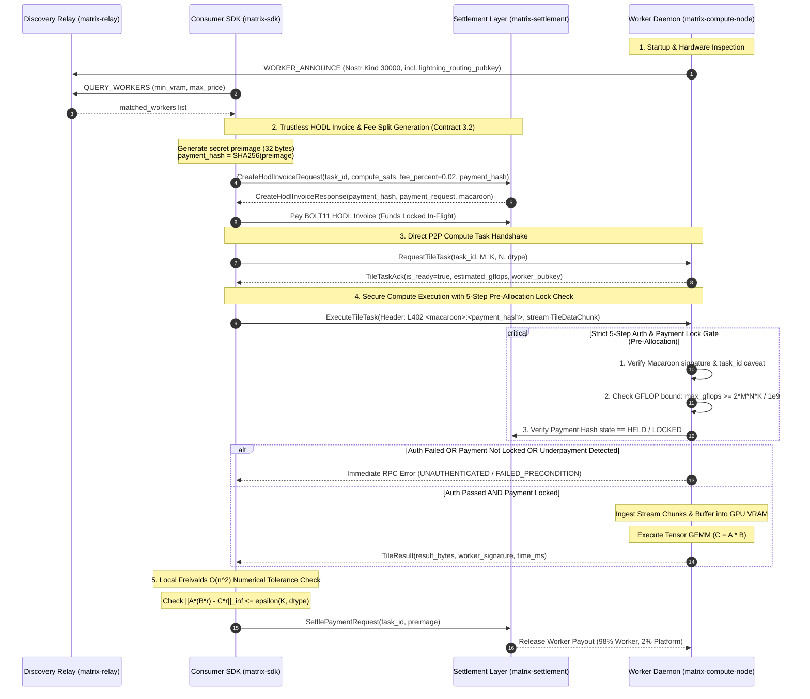

# High-Level Architecture: `matrix-compute-node` (Worker Daemon)

## 1. Overview
The `matrix-compute-node` is a lightweight, high-performance worker daemon running on decentralized GPU hardware providers. It participates in the Distributed Matrix Multiplication network by:
1. Attesting hardware capacity (VRAM, compute TFLOPS) and announcing availability via Nostr relays (`matrix-compute-relay`).
2. Servicing direct P2P gRPC/HTTP2 compute requests from Consumer SDKs (`matrix-compute-sdk`).
3. Cryptographically validating L402 payment macaroons and verifying HODL payment locks **before** accepting matrix streams or allocating VRAM to prevent resource exhaustion (DoS) attacks.
4. Importing protocol definitions and schemas directly from the central [`matrix-contracts`](file:///c:/Users/lcarp/Documents/sideprojects/DistributedMatrixMultiply/matrix-contracts) repository.
5. Accelerating block matrix GEMM computations ($C = A \times B$) via PyTorch / CuPy / CUDA.
6. Cryptographically signing computed matrix tile results to uphold worker bond guarantees.

---

## 2. System Architecture & Components

```
+-----------------------------------------------------------------------------------+
|                           matrix-compute-node (Daemon)                            |
|                                                                                   |
|  +------------------------+    +-----------------------+    +------------------+  |
|  |  Hardware Attestation  |    |  Relay Client (Nostr) |    | Worker Keypair & |  |
|  |   (NVML / GPU Detection|    | (Kind 30000 Announce) |    |  Tile Signer     |  |
|  +-----------+------------+    +-----------+-----------+    +--------+---------+  |
|              |                             |                         |            |
|              v                             v                         v            |
|  +-----------------------------------------------------------------------------+  |
|  |             Imports Schemas/Protobufs from `matrix-contracts`              |  |
|  +-----------------------------------------+-----------------------------------+  |
|                                            |                                      |
|                                            v                                      |
|  +-----------------------------------------+-----------------------------------+  |
|  |                    P2P gRPC / HTTP2 Compute Server Interface                 |  |
|  |                    (MatrixComputeService: Proto v1)                         |  |
|  +-----------------------------------------+-----------------------------------+  |
|                                            |                                      |
|                                            v                                      |
|  +-----------------------------------------+-----------------------------------+  |
|  |                  STRICT PRE-ALLOCATION L402 AUTH MODULE                     |  |
|  |         (Macaroon Verification & HODL Payment Lock Check FIRST)             |  |
|  +-----------------------------------------+-----------------------------------+  |
|                                            | (Only proceed if Auth & Lock pass)   |
|                                            v                                      |
|  +-----------------------------------------+-----------------------------------+  |
|  |                        Math Acceleration Compute Core                       |  |
|  |                    (PyTorch / CuPy / CUDA / FP32 / FP16)                    |  |
|  +-----------------------------------------------------------------------------+  |
+-----------------------------------------------------------------------------------+
```

### Component Breakdown

#### A. Shared Contracts Dependency (`matrix-contracts`)
- **No Local Proto Directory**: Protobuf generated files (`compute_service_pb2.py`, `compute_service_pb2_grpc.py`) and Pydantic schemas are imported directly from the [`matrix-contracts`](file:///c:/Users/lcarp/Documents/sideprojects/DistributedMatrixMultiply/matrix-contracts) repository.
- Ensures exact schema synchronization across `matrix-compute-sdk`, `matrix-compute-node`, `matrix-compute-relay`, and `matrix-compute-settlement`.

#### B. Hardware Attestation Engine (`src/attestation/`)
- Interrogates local GPU hardware via NVML (`pynvml`) with fallback subprocess calls to `nvidia-smi` / `nvidia-smi.exe` (and CPU fallback for dev/testing environments).
- Collects total and available VRAM (MB), peak FP32/FP16 TFLOPS, GPU model string, and CUDA driver version.
- Generates a signed hardware attestation payload to prevent spoofing of hardware capabilities.

#### C. Discovery Relay Client (`src/relay/`)
- Establishes persistent WebSocket connections to Nostr Discovery Relays (`matrix-compute-relay`).
- Publishes `WORKER_ANNOUNCE` (Nostr Kind 30000) events containing:
  - Worker public key (`worker_pubkey`).
  - Multiaddr connection endpoint (`p2p_multiaddr`).
  - Lightning node pubkey (`lightning_routing_pubkey`).
  - Hardware attestation metrics & VRAM capacity.
  - Compute pricing structure (`sats_per_gflop`, `min_task_sats`).
  - Staked bond status (`bond_status`).

#### D. P2P gRPC Compute Server Interface (`src/p2p/`)
- Implements `MatrixComputeService` from `matrix-contracts`:
  - `RequestTileTask`: Validates task parameters ($M \times N \times K$, `dtype`), calculates estimated GFLOPs, and returns a `TileTaskAck` readiness acknowledgement.
  - `ExecuteTileTask`: Receives streamed `TileDataChunk` messages for Matrix $A$ and Matrix $B$.

#### E. Strict Pre-Allocation L402 Payment & Auth Module (`src/auth/`)
- **Security & DoS Protection Strategy (5-Step Pre-Allocation Gate)**:
  `ExecuteTileTask` intercepts the incoming request **immediately** prior to allocating any GPU VRAM or consuming streamed tensor chunks:
  1. **Header Extraction**: Parses the `Authorization: L402 <macaroon>:<payment_hash>` metadata header. Rejects immediately if malformed.
  2. **Cryptographic Verification**: Validates the Macaroon's HMAC signature using the Settlement Platform's verification key.
  3. **Task & Expiry Caveats**: Asserts that `caveat.task_id == rpc.task_id` and `caveat.expiry > current_timestamp`.
  4. **Workload Bound Enforcement (GFLOP Underpayment Defense)**:
     - Calculates actual required compute: $\text{GFLOPs} = \frac{2 \times M \times N \times K}{10^9}$.
     - Asserts `caveat.max_gflops >= GFLOPs` and verifies that the locked payment meets the worker's advertised rate ($\text{sats} \ge \text{GFLOPs} \times \text{sats\_per\_gflop}$).
  5. **HODL Payment Lock Check**: Queries `matrix-settlement` to verify that the `payment_hash` status is actively in the `HELD` state.
  - **Zero-Allocation Enforcement**: If any of steps 1-5 fail, the RPC is rejected immediately with an `UNAUTHENTICATED` or `FAILED_PRECONDITION` gRPC status code. **Zero VRAM is allocated and data streams are rejected.**

#### F. Math Acceleration Compute Core (`src/engine/`)
- Invoked **only after** all 5 steps of the L402 pre-allocation gate succeed.
- Buffers incoming stream chunks directly into GPU VRAM (PyTorch / CuPy with CPU NumPy fallback).
- Computes GEMM block multiplication $C = A \times B$.
- Generates SHA256 cryptographic digest of result tensor $C$.

#### G. Cryptographic Signer & Fraud Defense (`src/crypto/`)
- Holds worker Secp256k1 keypair.
- Signs the result metadata (`task_id`, `result_bytes` SHA256 digest, execution time) to generate `worker_signature`.
- Protects worker's staked bond against Freivalds algorithm dispute claims, taking into account IEEE 754 floating point precision bounds $\epsilon(K, \text{dtype})$.

---

## 3. Data Flow & Execution Lifecycle (Trustless Escrow Aligned)



---

## 4. Repository Directory Structure

```
matrix-compute-node/
├── architecture.md                 # High-level architecture design document
├── src/
│   ├── __init__.py
│   ├── main.py                     # CLI entrypoint and daemon runner
│   ├── config.py                   # Configuration management (Pydantic / Settings)
│   ├── attestation/
│   │   ├── __init__.py
│   │   └── nvml_attest.py         # GPU VRAM & TFLOPS detection & attestation
│   ├── relay/
│   │   ├── __init__.py
│   │   └── nostr_client.py        # Nostr WebSocket client & Kind 30000 publisher
│   ├── auth/
│   │   ├── __init__.py
│   │   ├── macaroon.py            # L402 macaroon validation & verification
│   │   └── payment_verifier.py    # Settlement HODL payment lock status verifier
│   ├── p2p/
│   │   ├── __init__.py
│   │   ├── grpc_server.py         # MatrixComputeService implementation (uses matrix-contracts)
│   │   └── serializers.py         # Binary tensor serialization & stream handlers
│   ├── engine/
│   │   ├── __init__.py
│   │   └── compute_core.py        # PyTorch/CuPy GPU GEMM computation engine
│   └── crypto/
│       ├── __init__.py
│       └── signer.py              # Secp256k1 keypair signing for tile results
├── tests/
│   ├── test_attestation.py
│   ├── test_compute_engine.py
│   ├── test_l402_auth.py
│   └── test_p2p_server.py
├── pyproject.toml                  # Package setup with matrix-contracts dependency
└── README.md                       # Project quickstart and setup instructions
```

---

## 5. Technology Stack & Key Dependencies
- **Language**: Python 3.10+
- **Shared Contracts**: `matrix-contracts` (Protobuf definitions & Pydantic models)
- **Compute Backends**: PyTorch (`torch`), CuPy (`cupy`), NumPy (`numpy`)
- **P2P Communication**: `grpcio`, `protobuf`
- **Networking & Relay**: `websockets` (Nostr NIP-01/NIP-11), `httpx` / `aiohttp`
- **L402 & Cryptography**: `pymacaroons`, `ecdsa` / `coincurve` (Secp256k1)
- **Hardware Monitoring**: `pynvml` (NVIDIA Management Library)
- **Configuration & Validation**: `pydantic`, `pydantic-settings`
